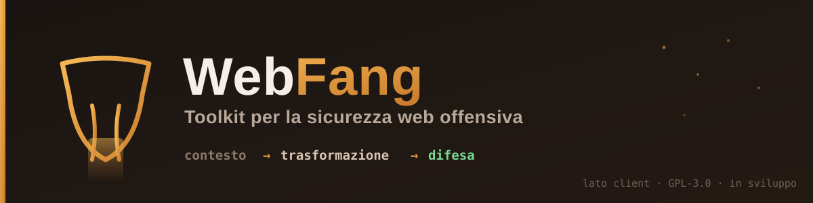

<p align="center">
  
</p>

<p align="center"><a href="README.md">🇬🇧 English</a> · <a href="README.it.md">🇮🇹 Italiano</a></p>

<p align="center">
  
  
  
  
  
  
</p>

# WebFang

> Trasforma una stringa, capisci cosa cambia e impara quale difesa serve nel
> contesto giusto.
>
> Un "coltellino svizzero" per la sicurezza offensiva del web, lato client, che
> lega **ogni trasformazione al suo contesto d'uso e alla sua contromisura
> difensiva** — usabile sia dagli esperti sia dai principianti.

<p align="center"><a href="docs/README.it.md"><strong>Documentazione</strong></a> · <a href="roadmap.md">Roadmap</a> · <a href="project.md">Specifica</a> · <a href="CONTRIBUTING.it.md">Contribuire</a> · <a href="SECURITY.it.md">Sicurezza</a> · <a href="https://github.com/chiaraberti13/WEBFANG/issues">Issue</a></p>

> [!IMPORTANT]
> **Sviluppo iniziale — fase di scaffold.** Il repository ha il contratto dati,
> il tooling di qualità e le fondamenta di progetto. Il motore ricetta, il
> catalogo delle trasformazioni, i pannelli Difesa e la modalità guidata sono
> in costruzione per incrementi (vedi [`roadmap.md`](roadmap.md), Fase 0 → MVP).

## Navigazione rapida

- [Cos'è WebFang?](#cosè-webfang)
- [Cosa esiste oggi?](#cosa-esiste-oggi)
- [Setup di sviluppo](#setup-di-sviluppo)
- [Principi di sicurezza e privacy](#principi-di-sicurezza-e-privacy)
- [Documentazione e roadmap](#documentazione-e-roadmap)
- [Licenza](#licenza)

## Cos'è WebFang?

WebFang è un "coltellino svizzero" per la sicurezza offensiva del web che gira
**interamente nel browser**. La sua identità non è "tante operazioni": è una sola
idea — **contesto → trasformazione → difesa**. Per ogni passaggio il tool mostra
sempre quattro cose:

1. **Cosa fa** la trasformazione.
2. **Dove è pertinente** e quali prerequisiti richiede.
3. **Cosa _non_ dimostra** (un payload generato non prova una vulnerabilità).
4. **Come difendersi**, con un esempio sicuro e un riferimento CWE/OWASP.

Un bug-bounty hunter o un pentester compone una **catena di trasformazioni**
(encode/decode, hashing, generazione di payload didattici), **la salva in un URL
condivisibile** e la riusa ogni giorno. Uno sviluppatore back-end decodifica un
JWT e copia la fix corretta nel proprio stack. Un principiante usa la modalità
guidata e il wizard "non so cosa mi serve".

## Cosa esiste oggi?

- Il **contratto dati testo/byte** (`src/core`): testo e byte espliciti, encoding
  dichiarato, errori strutturati e traducibili, annullamento e limiti di esecuzione.
- TypeScript severo, ESLint (con regole AppSec no-`eval`/no-`any`) e Prettier.
- Tooling pinnato e restrizioni sugli script d'installazione in [`.npmrc`](.npmrc).
- Un'impalcatura applicativa Vite + React 19, con variante di build normale (PWA)
  e single-file (un unico HTML, eseguibile da `file://`).
- Una specifica di prodotto, una roadmap di sviluppo e le decisioni tecniche (ADR).
- Questa presentazione bilingue e la documentazione pubblica.

Non è disponibile alcuna release. Non dedurre la sicurezza a runtime dai controlli
di scaffold. Vedi [stato dello sviluppo](docs/presentation/development-status.it.md).

## Setup di sviluppo

Installa Git, una linea Node.js accettata (**22.x o 24.x**) e **pnpm 10.28.0**
(via `corepack`). La versione Node esatta consigliata è in [`.nvmrc`](.nvmrc);
l'intervallo accettato è in [`package.json`](package.json) e nell'
[ADR 0001](docs/adr/0001-stack.md).

```bash
git clone https://github.com/chiaraberti13/WEBFANG.git
cd WEBFANG
corepack enable
pnpm install --frozen-lockfile
pnpm typecheck
pnpm lint
pnpm format:check
pnpm test
```

Per avviare l'app o produrre le due varianti di build:

```bash
pnpm dev                 # server di sviluppo locale
pnpm build               # build di produzione (PWA, usabile offline)
pnpm build:singlefile    # un unico file HTML, eseguibile da file://
```

Gli script di lifecycle delle dipendenze sono disabilitati per default (vedi
[`.npmrc`](.npmrc)).

## Principi di sicurezza e privacy

Input, token e chiavi vengono elaborati **localmente**; l'app non li trasmette a
servizi remoti. Nessun font, script o asset di terze parti viene caricato a
runtime. La UI **non esegue mai** i payload: sono resi come testo; l'HTML viene
sanificato con DOMPurify solo dove un'anteprima live è davvero necessaria. Un
payload generato è didattico e inerte — **non prova una vulnerabilità**.

Usa il tool solo su sistemi, file e account propri o esplicitamente autorizzati.
Leggi [ambito di sicurezza e segnalazione](SECURITY.it.md) e la
[promessa di privacy](project.md#part-b--security-and-privacy).

## Documentazione e roadmap

[Panoramica](docs/presentation/overview.it.md) ·
[Stato dello sviluppo](docs/presentation/development-status.it.md) ·
[Tutta la documentazione](docs/README.it.md)

La documentazione pubblica è disponibile in inglese e italiano. La UI a runtime è
bilingue IT/EN by design; le specifiche tecniche, gli ADR e
[`roadmap.md`](roadmap.md) restano in inglese. Vedi
[ADR 0004](docs/adr/0004-bilingual-public-documentation.md).

I contributi usano branch dedicati e pull request. Consulta
[CONTRIBUTING.it.md](CONTRIBUTING.it.md) prima di modificare codice o documentazione.

## Licenza

WebFang è distribuito sotto **licenza GNU GPL-3.0**. Vedi [`LICENSE`](LICENSE) per
i termini completi. Le dipendenze di terze parti restano soggette alle proprie licenze.
