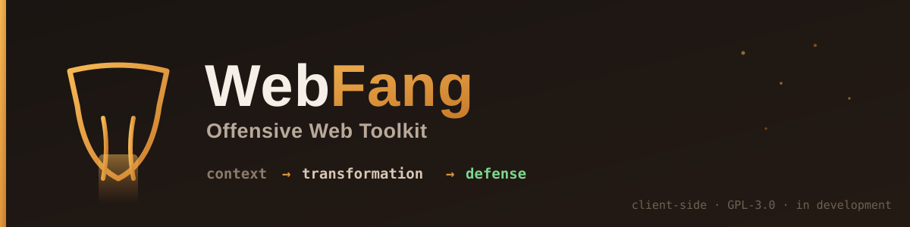

<p align="center">
  
</p>

<p align="center"><a href="README.md">🇬🇧 English</a> · <a href="README.it.md">🇮🇹 Italiano</a></p>

<p align="center">
  
  
  
  
  
  
</p>

# WebFang

> Transform a string, understand what changes, and learn which defense fits the
> right context.
>
> A client-side "offensive web" toolkit that binds every transformation to its
> **context of use** and its **defensive countermeasure** — usable by experts
> and beginners alike.

<p align="center"><a href="docs/ROADMAP.md"><strong>Roadmap</strong></a> · <a href="SECURITY.md">Security</a> · <a href="CONTRIBUTING.md">Contributing</a> · <a href="descrizione.md">Project description</a> · <a href="LICENSE">Licence</a> · <a href="https://github.com/chiaraberti13/WEBFANG/issues">Issues</a></p>

> [!IMPORTANT]
> **Early development — scaffold stage.** The repository has the data contract,
> quality tooling and project foundations. The recipe engine, the transformation
> catalogue, the defense panels and the guided mode are being built incrementally
> (see [`docs/ROADMAP.md`](docs/ROADMAP.md), Phase 0 → MVP).

## Quick navigation

- [What is WebFang?](#what-is-webfang)
- [What exists today?](#what-exists-today)
- [Development setup](#development-setup)
- [Security and privacy principles](#security-and-privacy-principles)
- [Documentation and roadmap](#documentation-and-roadmap)
- [Licence](#licence)

## What is WebFang?

WebFang is a "Swiss-army knife" for offensive web security that runs **entirely
in the browser**. Its identity is not "many operations": it is a single idea —
**context → transformation → defense**. For every step the tool always shows
four things:

1. **What** the transformation does.
2. **Where** it is relevant and which prerequisites it needs.
3. **What it does _not_ prove** (a generated payload is not proof of a vulnerability).
4. **How to defend**, with a safe example and a CWE/OWASP reference.

A bug-bounty hunter or a pentester composes a **chain of transformations**
(encode/decode, hashing, didactic payload generation), **saves it in a shareable
URL** and reuses it daily. A back-end developer decodes a JWT and copies the
correct fix into their stack. A beginner uses the guided mode and the
"I don't know what I need" wizard.

## What exists today?

- The **text/byte data contract** (`src/core`): explicit text vs bytes, declared
  encoding, structured translatable errors, cancellation and execution limits.
- Strict TypeScript, ESLint (with no-`eval`/no-`any` AppSec rules) and Prettier.
- Pinned tooling and dependency-install restrictions in [`.npmrc`](.npmrc).
- A Vite + React 19 application shell, with a normal (PWA) and a single-file
  build variant (one HTML file, runnable from `file://`).
- A development roadmap ([`docs/ROADMAP.md`](docs/ROADMAP.md)) and a bilingual
  project description ([`descrizione.md`](descrizione.md)).
- This bilingual presentation (README EN/IT).

No release is available yet. Do not infer runtime security from scaffold checks.

## Development setup

Install Git, an accepted Node.js line (**22.x or 24.x**) and **pnpm 10.28.0**
(via `corepack`). The recommended exact Node version is in [`.nvmrc`](.nvmrc);
the accepted range is in [`package.json`](package.json).

```bash
git clone https://github.com/chiaraberti13/WEBFANG.git
cd WEBFANG
corepack enable
pnpm install --frozen-lockfile
pnpm typecheck
pnpm lint
pnpm format:check
pnpm test
```

To run the app locally or produce the two build variants:

```bash
pnpm dev                 # local dev server
pnpm build               # production build (PWA, offline-capable)
pnpm build:singlefile    # single HTML file, runnable from file://
```

Dependency lifecycle scripts are disabled by default (see [`.npmrc`](.npmrc)).

## Security and privacy principles

Input, tokens and keys are processed **locally**; the app does not transmit them
to remote services. No third-party font, script or asset is loaded at runtime.
The UI **never executes** payloads: they are rendered as text; HTML is sanitized
with DOMPurify only where a live preview is genuinely required. A generated
payload is didactic and inert — **it is not proof of a vulnerability**.

Use only on systems, files and accounts you own or are explicitly authorized to
test. Read [security scope and reporting](SECURITY.md).

## Documentation and roadmap

The project document and phased plan live in [`docs/ROADMAP.md`](docs/ROADMAP.md);
a bilingual, CV-oriented description is in [`descrizione.md`](descrizione.md).

Public documentation is available in English and Italian. The runtime UI is
bilingual IT/EN by design; the roadmap document is authored in Italian.

Contributions use dedicated branches and pull requests. Consult
[CONTRIBUTING.md](CONTRIBUTING.md) before changing code or documentation.

## Licence

WebFang is distributed under the **GNU GPL-3.0 License**. See [`LICENSE`](LICENSE)
for the full terms. Third-party dependencies remain subject to their own licences.

## Community and collaboration

- [Contributing](CONTRIBUTING.md)
- [Code of conduct](CODE_OF_CONDUCT.md)
- [Security reports](SECURITY.md)
- [Accessibility and verification limits](ACCESSIBILITY.md)
- [Report a problem or propose an improvement](https://github.com/chiaraberti13/WEBFANG/issues/new/choose)
- [Project license](LICENSE)
