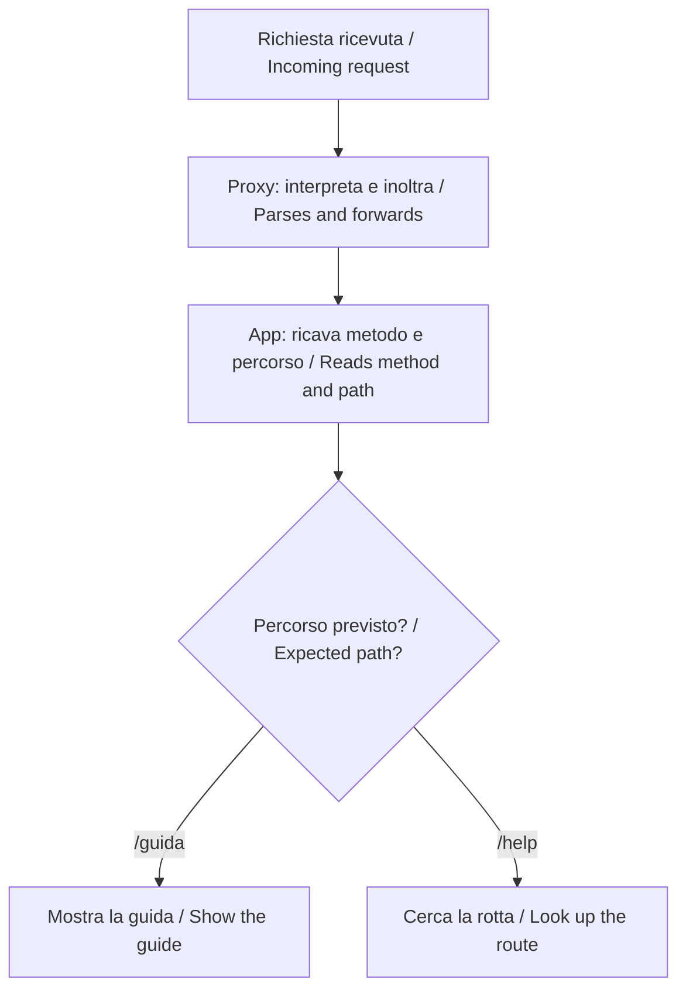

<p align="center"><sub>Progetto · documento di impostazione e roadmap · v3.0 · 2026-10-30</sub></p>

# 🦷 WebFang — Offensive Web Toolkit

> **Trasforma una stringa, capisci cosa cambia e impara quale difesa serve nel contesto giusto.**
> *Transform a string, understand what changes, and learn which defense fits the right context.*

**Nome:** `WebFang` — nome proprio e indipendente, non legato all'ecosistema Olympus. Evoca "il morso sul web": corto, aggressivo, memorabile. Disponibilità: non risultano tool di sicurezza affermati con questo nome (solo un piccolo toolkit OSINT omonimo e non confermato, in ambito diverso). Resta modificabile.

> 🧭 **In una riga:** un "coltellino svizzero" per la sicurezza offensiva del web, **nel browser** (elaborazione locale), con **ogni trasformazione legata al suo contesto e alla sua difesa**, bello e usabile **anche da chi non è esperto**.

> 📌 **Cosa è cambiato dalla v2.1 (sintesi delle revisioni).** L'identità non è "tante operazioni" ma il collegamento **contesto → trasformazione → difesa**. L'MVP è stato **ristretto a tre flussi impeccabili**. La promessa "privacy totale" è stata **corretta** in una formulazione verificabile. È stato aggiunto un **modello dati testo/byte** prima di ampliare la UI. La roadmap parte da una **prova di fattibilità** e sposta i ruoli in appendice. Il team passa da ~20 ruoli a **3 cappelli realistici**. La licenza consigliata diventa **Apache-2.0**. Sono entrate killer feature (importer CyberChef, wizard per principianti, PWA anticipata, Defense Playground).

---

## ✅ Stato di avanzamento (implementazione) — aggiornato 2026-11-28

Audit di `main` al commit `df7c0de`. L’app è funzionante e in consolidamento. La [CI di riferimento](https://github.com/chiaraberti13/WEBFANG/actions/runs/46152865895) ha completato installazione da checkout pulito, lint, typecheck, formattazione, unit test, build PWA e HTML autonomo ed E2E Chromium con axe e controlli di rete. Non risultano issue aperte né GitHub Release. Le competenze applicate sono definite in [COMPETENZE.md](COMPETENZE.md).

| Area / Fase | Stato | Evidenza (commit) |
| --- | --- | --- |
| Fase 0 — contratto testo/byte, worker inline da `file://`, PWA, scaffolding, CI | FEATURE_DONE | scaffold iniziale |
| Fase 1 — vertical slice (OperationCard + DefensePanel) | FEATURE_DONE | `71865b9` |
| Fase 2 · flusso 1 — "capire una stringa" (Base64/URL/HTML/Hex/SHA-256) | FEATURE_DONE | `0aa9622` |
| Fase 2 · flusso 2 — "comporre" (motore ricetta, undo/redo, share URL, import/export) | FEATURE_DONE | `063467a`, `c5e0648` |
| Fase 2 · flusso 3 — "contesto XSS" (payload inerti + difesa) | FEATURE_DONE | `fb47794` |
| Fase 2 — usabilità non esperti (wizard, onboarding, modalità guidata/esperto) | FEATURE_DONE | `44945d1` |
| Qualità — gate a11y (axe) + e2e Playwright + "no rete inattesa" | FEATURE_DONE | `eee5345` |
| Fase 4 — JWT Workbench (decode ≠ verify, `alg:none`) | FEATURE_DONE | `75a35bb` |
| Fase 4 — payload pack (SQLi/SSTI/LFI/cmd/SSRF/open-redirect) | FEATURE_DONE | `07882d2` |
| Fase 4 — remediation copy-paste multi-linguaggio | FEATURE_DONE | `43cc675` |
| Fase 4 — Defense Playground (DOMPurify) | FEATURE_DONE | `3fe25e5` |
| Fase 4 — hashing esteso SHA-1/384/512 | FEATURE_DONE | `0cb976d` |
| Fase 4 — Regex tester anti-ReDoS (Web Worker) | FEATURE_DONE | `bc0db68` |
| Toolkit HTTP — Set-Cookie inspector | FEATURE_DONE | `63d2df0` |
| Toolkit HTTP — CSP analyzer | FEATURE_DONE | `41592e8` |
| Trasformazioni Unicode escape/unescape | FEATURE_DONE | `df7c0de`, catalogo operazioni e test dedicati |

### Attività residue e criteri di chiusura

| ID | Stato | Priorità / stima | Dipendenze | Criterio ed evidenza |
| --- | --- | --- | --- | --- |
| DOC-01 | FEATURE_DONE | P1 / bassa | — | README IT/EN allineati al catalogo e all'architettura in `src/`, con link reciproci e licenza GPL-3.0. |
| CSP-01 | FEATURE_DONE | P1 / bassa | — | La prima direttiva CSP resta effettiva, le copie sono segnalate come ignorate e la capitalizzazione delle parole chiave non cambia l'esito. Regressioni in `src/lib/csp.test.ts` superate sul commit `2ad6576` ([CI](https://github.com/chiaraberti13/WEBFANG/actions/runs/46153142301)). |
| HTTP-01 | TODO | P2 / media | — | Ispezione locale di richieste HTTP testuali, con metodo, percorso e intestazioni, senza invio di traffico. Test con messaggi sintetici validi e malformati. |
| UX-01 | PARTIAL | P2 / bassa | — | Diagramma bilingue documentato nella sezione B. Restano l'integrazione nell'app e la verifica di comprensione. |
| HASH-01 | TODO | P2 / media | — | Valutare HMAC, MD5 per compatibilità esplicita e worker per input grandi. Vettori noti, gestione delle chiavi e misure su PWA e HTML autonomo. |
| RECIPE-01 | TODO | P3 / media | — | Importare ricette CyberChef per trasformazioni generiche supportate e segnalare le operazioni incompatibili. Fixture di migrazione e round-trip. |
| UX-02 | TODO | P3 / media | — | Riconoscere formati di codifica con spiegazione dell'ipotesi e conferma manuale. Fixture ambigue e controllo dei falsi positivi. |
| QA-01 | PARTIAL | P1 / alta | Funzionalità previste per v1.0 | Estendere la baseline Chromium a Firefox e WebKit. Verificare coverage, Lighthouse (prestazioni e accessibilità ≥ 90), usabilità, parità IT/EN, dipendenze, segreti e configurazione di produzione sul candidato. |
| REL-01 | TODO | P1 / media | QA-01 | Verificare deployment e rollback, protezioni finali di main e versione nel changelog. Pubblicare il tag stabile e verificarne il commit. |

La licenza effettiva è GPL-3.0. I riferimenti ad Apache-2.0 nelle sezioni storiche riportano una proposta iniziale. Il repository contiene la configurazione Vercel. L'URL pubblico resta da verificare.

Il dettaglio tecnico e i criteri di ciascuna fase restano nelle sezioni sottostanti.

---

## ⏱️ Stima di sviluppo (sintesi)

| Traguardo | Durata (team piccolo dedicato) | Effort |
| --- | --- | --- |
| Prova di fattibilità + vertical slice | ~2 settimane | ~12 gg/uomo |
| MVP ristretto pubblicabile | ~4–5 settimane | ~28 gg/uomo |
| **v1.0 "da colloquio"** | **~9–12 settimane (2–3 mesi)** | **~65–80 gg/uomo** |
| Fase crescita | continua | — |

> ⚠️ **I tempi sono un'ipotesi da ricalibrare dopo il primo incremento, non una promessa.** L'effort dipende dalla reale disponibilità delle persone e dalla profondità dei contenuti didattici. *Ipotesi: team piccolo dedicato (vedi [appendice ruoli](#-appendice-il-team-ideale-per-disciplina)). Persona sola part-time → ×2–3.*

---

## 📑 Indice

1. [TL;DR](#-tldr)
2. [Ricerca di settore](#-ricerca-di-settore)
3. [Pubblico, personas e casi d'uso](#-pubblico-personas-e-casi-duso)
4. [Proposta di valore unica](#-proposta-di-valore-unica)
5. [Modello dati: il contratto testo/byte](#-modello-dati-il-contratto-testobyte)
6. [Funzionalità in dettaglio (MVP ristretto)](#-funzionalità-in-dettaglio-mvp-ristretto)
7. [Il cuore del prodotto: Attacco ⇄ Difesa](#-il-cuore-del-prodotto-attacco--difesa)
8. [Architettura tecnica e stack](#-architettura-tecnica-e-stack)
9. [Nodi tecnici da risolvere subito](#-nodi-tecnici-da-risolvere-subito)
10. [Design, UI/UX e identità visiva](#-design-uiux-e-identità-visiva)
11. [Usabilità per utenti non esperti](#-usabilità-per-utenti-non-esperti)
12. [Accessibilità](#-accessibilità)
13. [Privacy: promessa precisa e verificabile](#-privacy-promessa-precisa-e-verificabile)
14. [Threat model e sicurezza come test concreti](#-threat-model-e-sicurezza-come-test-concreti)
15. [Etica, aspetti legali e licenza](#-etica-aspetti-legali-e-licenza)
16. [Modello di sviluppo, governance e pubblicazione](#-modello-di-sviluppo-governance-e-pubblicazione)
17. [Hosting e deploy (Vercel)](#-hosting-e-deploy-vercel)
18. [Comunicazione, crescita e SEO](#-comunicazione-crescita-e-seo)
19. [KPI: utilità e comprensione, non solo traffico](#-kpi-utilità-e-comprensione-non-solo-traffico)
20. [Il team: 3 cappelli realistici](#-il-team-3-cappelli-realistici)
21. [Roadmap a fasi (feasibility-first)](#-roadmap-a-fasi-feasibility-first)
22. [Rischi e mitigazioni](#-rischi-e-mitigazioni)
23. [Appendice: il team ideale per disciplina](#-appendice-il-team-ideale-per-disciplina)

---

## 🎯 TL;DR

WebFang è un **coltellino svizzero per la sicurezza offensiva del web**, con elaborazione **client-side** (gira nel browser; input, token e chiavi non vengono trasmessi a servizi remoti). Un bug bounty hunter o un pentester costruisce una **catena di trasformazioni** (encode/decode, hashing, generazione di payload didattici), **la salva in un URL condivisibile** e la riusa ogni giorno. Rispetto a tutto ciò che esiste oggi, l'identità sta in **un** punto, non in venti:

> **Ogni trasformazione è legata al suo contesto d'uso e alla sua contromisura difensiva.** Non "fa tante cose": fa *capire* cosa cambia in una stringa e *come ci si difende* nel contesto giusto.

Questo significa, concretamente, che per ogni passaggio WebFang mostra sempre **quattro cose**:

1. **Cosa fa** la trasformazione.
2. **Dove è pertinente** e quali prerequisiti richiede.
3. **Cosa *non* dimostra** (un payload generato non prova una vulnerabilità).
4. **Come difendersi**, con esempio sicuro e riferimento CWE/OWASP.

Il secondo tratto distintivo: è pensato per essere **usato anche da non esperti** (modalità guidata, linguaggio semplice, esempi precaricati, wizard "non so cosa mi serve").

- **Formato:** Single Page Application statica, deployabile anche come **singolo file HTML** e installabile come **PWA offline** (uso in VM isolate durante i pentest on-premises).
- **Perché porta traffico:** strumento d'uso *quotidiano* → ritorno costante; condivisione di "ricette" via URL; SEO su centinaia di query tecniche.

---

## 🔍 Ricerca di settore

Dati raccolti il 2026-10-30:

- **Gli strumenti client-side "da browser" sono quelli che fanno più numeri e fidelizzano.** CyberChef (GCHQ) è intorno alle **~35k stelle** ed è arrivato **#1 in GitHub Trending**. I motivi citati sono i tre pilastri su cui WebFang si innesta: **elaborazione locale** (nulla inviato al server), **ampiezza** (300+ operazioni componibili), **zero installazione** (compilabile in un unico file HTML, condivisibile e usabile offline). Fonti: [CyberChef su GitHub](https://github.com/gchq/CyberChef), [i-programmer](https://www.i-programmer.info/news/90/13117.html), [ossinsight](https://ossinsight.io/analyze/gchq/CyberChef).
- **Spazio di posizionamento libero.** CyberChef è *generalista*. Un toolkit **focalizzato sull'offensive web security** con payload contestuali, cheat-sheet interattivi **e una modalità per non esperti** è una nicchia scoperta e molto cercata.
- **Cosa premia la community:** progetti che mostrano **ragionamento, non solo uso di tool**, con **finding → impatto → remediation**, documentazione e condivisione pubblica. Fonti: [TryHackMe – building a portfolio](https://tryhackme.com/resources/blog/how-to-build-a-cyber-security-portfolio-that-gets-you-hired-in-2027), [Pentest portfolio projects](https://codelabsacademy.com/en/blog/pentest-portfolio-ethical-hacking-projects-2026).

---

## 👥 Pubblico, personas e casi d'uso

**Persona A — "Marco, bug bounty hunter".** Vuole velocità: costruisce varianti di payload, le prova, salva la ricetta. Usa WebFang in modalità esperto, da tastiera.

**Persona B — "Sara, studentessa di web security".** Sta imparando: le serve capire *perché* un payload funziona, *in quale contesto* e *come* ci si difende. Usa la modalità guidata, il wizard e i pannelli "Difesa".

**Persona C — "Luca, sviluppatore back-end non esperto di security".** Deve solo decodificare un JWT o capire un encoding strano in una risposta API — e magari copiare la fix corretta nel suo stack. Vuole un'interfaccia che non lo faccia sentire perso.

**Casi d'uso tipici**
1. "Input riflesso: fammi capire quali payload XSS sono pertinenti per i diversi contesti (attributo, tag, JS, URL), con i prerequisiti e la difesa contestuale di ciascuno."
2. "Decodifica questo JWT, mostrami header/claim; se fornisco anche una chiave, verifica la firma e separa chiaramente la validità della firma dalla validazione di scadenza/issuer/audience."
3. "Trasforma il payload passando per URL-encode → doppio URL-encode → base64 → unicode escape, mostrando ogni passaggio e il tipo (testo/byte) a ogni stadio."
4. "Spiegami in parole semplici in quale contesto questo payload è pertinente e come un sito si difende, con uno snippet copy-paste nel mio linguaggio."

---

## 💎 Proposta di valore unica

1. **Contesto → trasformazione → difesa** come esperienza principale, non come scheda accessoria. È qui l'identità del prodotto.
2. **Elaborazione locale.** Input, token e chiavi vengono elaborati nel browser e **non** trasmessi a servizi remoti (vedi [Privacy](#-privacy-promessa-precisa-e-verificabile) per la formulazione precisa e i suoi limiti).
3. **Ricette componibili e condivisibili** via URL (`#recipe=…`), con condivisione **sicura per default** (solo operazioni e parametri non sensibili; input e segreti mai serializzati senza consenso esplicito).
4. **Doppio livello: esperto e principiante** → lo stesso strumento serve il bug hunter e il novizio, grazie a modalità guidata, wizard e glossario.
5. **Remediation azionabile:** per ogni attacco didattico, una fix **copy-paste** nel linguaggio dell'utente, non solo teoria.
6. **Bilingue IT/EN**, bello, accessibile, usabile **offline** (PWA / single-file).

---

## 🧱 Modello dati: il contratto testo/byte

> **Prima di ampliare la UI, si definisce il contratto dei dati.** Base64, hashing e compressione lavorano sui **byte**: trattare tutto come stringhe produce risultati ambigui o errati (es. un Base64 di dati binari, o un hash di un input non-UTF-8). Questo capitolo è un **prerequisito della Fase 0** e non va rimandato.

### Tipi di valore

Ogni valore che scorre nella ricetta è esplicitamente **testo** o **byte**:

```ts
// valore che attraversa la catena
type WfValue =
  | { kind: 'text'; value: string; encoding: 'utf-8' }   // encoding dichiarato, default UTF-8
  | { kind: 'bytes'; value: Uint8Array };

// metadati di un'operazione
interface Operation<P = Record<string, unknown>> {
  id: string;                       // es. 'base64-encode'
  category: 'transform' | 'analyze' | 'generate';
  accepts: ('text' | 'bytes')[];    // tipi di input ammessi
  produces: 'text' | 'bytes' | 'report';
  paramsSchema: ZodSchema<P>;        // schema validato dei parametri
  run(input: WfValue, params: P, ctx: RunContext): Promise<WfResult>;
}
```

### Tre famiglie, tre contratti distinti

Decodificare Base64, ispezionare un JWT e produrre esempi XSS **non hanno lo stesso contratto** di input/output. Si distinguono quindi:

| Famiglia | Input → Output | Esempi |
| --- | --- | --- |
| **Transform** | `WfValue → WfValue` | Base64, URL-encode, Hex, Gzip |
| **Analyze** | `WfValue → report` (struttura, non muta la catena) | JWT inspector, CSP analyzer, Set-Cookie parser |
| **Generate** | `params → WfValue` (nessun input obbligatorio) | esempi XSS/SQLi didattici |

### Requisiti del contratto (tutti verificabili con test)

- **Tipi espliciti** per testo e byte; conversione solo esplicita e dichiarata.
- **Encoding dichiarato**, UTF-8 come default; errori di decodifica gestiti, mai silenziosi.
- **Schema parametri validato** (Zod) per ogni operazione; input fuori schema → errore strutturato.
- **Versione del formato ricetta** + **migrazioni** (`recipeFormat: 2`) per non rompere i link salvati.
- **Limiti** di dimensione input, tempo di esecuzione e dimensione output (vedi [nodi tecnici](#-nodi-tecnici-da-risolvere-subito)).
- **Annullamento** delle elaborazioni in corso (`AbortSignal`), con garanzia che un risultato vecchio non sovrascriva uno nuovo.
- **Errori strutturati e traducibili** (`{ code, params }` → testo IT/EN), mai stack trace in UI.

Documentazione di riferimento: [Zod](https://zod.dev/), [`Uint8Array`/`TextEncoder` (MDN)](https://developer.mozilla.org/en-US/docs/Web/API/TextEncoder), [`AbortController` (MDN)](https://developer.mozilla.org/en-US/docs/Web/API/AbortController).

---

## 🧰 Funzionalità in dettaglio (MVP ristretto)

> **Principio guida:** *meglio otto operazioni impeccabili che trenta con casi limite poco gestiti.* L'MVP si concentra su **tre flussi completi**. Tutto il resto è rimandato a incrementi successivi, a partire dal JWT Workbench.

### MVP — i tre flussi (v0.1)

| Flusso | Operazioni / funzioni | Nota |
| --- | --- | --- |
| **1. Capire una stringa** | Base64 / Base64URL, URL-encode (singolo/doppio), HTML entities, Hex, **SHA-256** | SHA-256 è la prima operazione crittografica, sul contratto a byte |
| **2. Comporre trasformazioni** | Catena di operazioni, riordino **accessibile** (non solo drag & drop), risultati intermedi per step, **undo/redo** | Il motore "ricetta" vero e proprio |
| **3. Capire un contesto XSS** | Esempi didattici per contesto (HTML body, attributo, JS string, URL, SVG), **prerequisiti** e **difesa contestuale** | Qui il pannello Difesa è protagonista |

Più le funzioni trasversali indispensabili: **ricetta condivisibile via URL** (condivisione sicura per default), **export/import JSON** con validazione, **copia output**, **i18n IT/EN**, **tema chiaro/scuro**, **onboarding** (3 schermate) e **wizard "non so cosa mi serve"** per i principianti.

### 🔜 Rimandato (primo incremento dopo l'MVP)

- **JWT Workbench** — primo incremento, utile anche agli sviluppatori non specialisti e facilmente riconoscibile come funzione autonoma (vedi precisazioni nei [nodi tecnici](#-nodi-tecnici-da-risolvere-subito)).

### 🔜 Rimandato (fasi successive)

- Hashing esteso (MD5, SHA-1/384/512, HMAC), compressione (Gzip/Deflate), ROT/charcode, Unicode escape.
- **Payload pack estesi**: SQLi (per DB), SSTI (Jinja2/Twig/Freemarker…), LFI/Path traversal, command injection, SSRF, open redirect — ciascuno con payload **inerti** + difesa + OWASP/CWE.
- **Toolkit HTTP** (builder/parser request, cookie inspector, CSP analyzer, Set-Cookie parser).
- **Regex builder/tester** (anti-ReDoS, in worker) e **diff** output.
- **"Magic" / auto-detect** dell'operazione probabile.
- **Importer ricette CyberChef** e **Defense Playground** (vedi sotto).

---

## 🛡️ Il cuore del prodotto: Attacco ⇄ Difesa

Il binomio attacco/difesa è l'elemento che stacca WebFang da CyberChef. Va reso **concreto e interattivo**, non teorico. Il pannello Difesa è parte dell'esperienza principale: compare accanto a ogni trasformazione/payload, non in una scheda nascosta.

### A. Snippet di remediation multi-linguaggio ("Copy-Paste Fix")

Per ogni payload generato, il tab "Difesa" mostra **codice pronto da incollare**, non solo il principio:

- **SQLi** → Node.js (Prisma / `pg`), Python (SQLAlchemy / psycopg3), PHP (PDO prepared), Go (`database/sql`).
- **XSS** → contextual encoding in React (JSX nativo), Blade/Twig, Go templates. Nota didattica esplicita: **la CSP è una difesa *aggiuntiva*, non un sostituto dell'output encoding contestuale.**
- **SSRF** → allowlist IP corretta + disabilitazione dei redirect HTTP nel client standard.

### B. Interpretazione della richiesta / Request interpretation



**IT.** In questo esempio, il proxy inoltra `/help` come `/guida` per una regola di riscrittura. L'applicazione riceve `/guida` e usa quel percorso per scegliere la pagina. Un test d'integrazione può verificare quale percorso vede ciascun componente e che i controlli di accesso si applichino alla risorsa effettivamente servita.

**EN.** In this example, a rewrite rule forwards `/help` as `/guida`. The application receives `/guida` and uses that path to select the page. An integration test can verify which path each component sees and whether access checks apply to the resource actually served.

### C. "Defense Playground" (sanitizer in-browser)

Una tab in cui l'utente inserisce il payload generato dentro una simulazione di [`DOMPurify`](https://github.com/cure53/DOMPurify) (con configurazioni permissive/restrittive) o dentro funzioni di escape, per vedere **in tempo reale** se il payload sopravvive. Chiude il cerchio: dall'attacco alla verifica della difesa.

### Cosa un payload *non* dimostra

Regola didattica presente ovunque nel prodotto: **un payload generato non prova una vulnerabilità**. WebFang genera esempi inerti per capire contesto e difesa, non conferme di exploit.

---

## 🏗️ Architettura tecnica e stack

Tutto **client-side**.

| Area | Scelta | Documentazione |
| --- | --- | --- |
| Linguaggio | **TypeScript** | [typescriptlang.org/docs](https://www.typescriptlang.org/docs/) |
| UI | **React 19** | [react.dev](https://react.dev) |
| Build | **Vite** | [vite.dev](https://vite.dev) |
| Single-file | **vite-plugin-singlefile** | [github.com/richardtallent/vite-plugin-singlefile](https://github.com/richardtallent/vite-plugin-singlefile) |
| PWA | **@vite-pwa/plugin** | [vite-pwa-org.netlify.app](https://vite-pwa-org.netlify.app/) |
| Stile | **Tailwind CSS** | [tailwindcss.com/docs](https://tailwindcss.com/docs) |
| Stato | **Zustand** (`persist`) | [zustand.docs.pmnd.rs](https://zustand.docs.pmnd.rs/) |
| Validazione schema | **Zod** | [zod.dev](https://zod.dev/) |
| Compressione URL | **lz-string** (o Deflate nativo) | [github.com/pieroxy/lz-string](https://github.com/pieroxy/lz-string) |
| Virtualizzazione | **@tanstack/react-virtual** | [tanstack.com/virtual](https://tanstack.com/virtual/latest) |
| JWT | **`jose`** | [github.com/panva/jose](https://github.com/panva/jose) |
| Hashing | **WebCrypto** + `hash-wasm` | [MDN WebCrypto](https://developer.mozilla.org/en-US/docs/Web/API/Web_Crypto_API), [hash-wasm](https://github.com/Daninet/hash-wasm) |
| Calcolo pesante | **Web Workers** | [MDN Web Workers](https://developer.mozilla.org/en-US/docs/Web/API/Web_Workers_API) |
| Rendering sicuro | **DOMPurify** | [github.com/cure53/DOMPurify](https://github.com/cure53/DOMPurify) |
| Test | **Vitest** + **Playwright** | [vitest.dev](https://vitest.dev), [playwright.dev](https://playwright.dev) |
| Hosting | **Vercel** | [vercel.com/docs](https://vercel.com/docs) |

**Principi architetturali:**
- **Logica pura separata dalla UI:** ogni operazione è una funzione testata singolarmente, conforme al [contratto testo/byte](#-modello-dati-il-contratto-testobyte). Aggiungere un payload = aggiungere **dati**, non codice.
- **Operazioni pesanti nei Web Worker**, con terminazione al timeout.
- **Determinismo:** stesso input + stessa ricetta = stesso output.
- **Nessun backend, nessuna telemetria invasiva, nessun asset di terze parti a runtime.**

```
src/
├─ core/       # contratto WfValue, tipi testo/byte, errori strutturati, abort
├─ lib/        # operazioni pure testabili (encode, hash, jwt, payloads…) + test
├─ recipes/    # definizione dichiarativa di operazioni e payload pack (dati)
│  ├─ serialize.ts   # pipeline URL: JSON → compress → Base64URL + fallback
│  └─ migrate.ts     # migrazioni del formato ricetta
├─ content/    # testi didattici "Attacco/Difesa" + snippet remediation (dati)
├─ components/ # UI: RecipeBoard, OperationCard, DefensePanel, Wizard, JwtWorkbench…
├─ workers/    # calcolo pesante (hash, regex) — inlinabili via Blob nel single-file
├─ store.ts    # stato (ricetta, tema, lingua) con persist
├─ i18n/       # cataloghi IT/EN
└─ App.tsx
```

---

## 🔧 Nodi tecnici da risolvere subito

Questi punti vanno affrontati **in Fase 0 come prova di fattibilità**, non lasciati come sorpresa alla fine.

### 1. Serializzazione dello stato nell'URL (`#recipe=…`)
Una ricetta a più passaggi genera URL enormi; browser, proxy e chat (Slack/Discord) troncano o rompono i link lunghi.
- **Pipeline di compressione:** `Recipe JSON → (MessagePack/CBOR opzionale) → Deflate/lz-string → Base64URL`.
- **Fallback locale:** se l'URL supera **~1.800 caratteri**, WebFang non genera un link rotto: avvisa l'utente e propone **export JSON** o **copia negli appunti**.
- **Nota privacy:** il fragment `#recipe=` normalmente non viaggia nella richiesta HTTP, ma finisce in cronologia, clipboard, screenshot, messaggi. Vedi [Privacy](#-privacy-promessa-precisa-e-verificabile): per default si serializzano **solo operazioni e parametri non sensibili**.

### 2. Web Workers + build single-file HTML
Con `vite-plugin-singlefile`, un `new Worker(new URL('./worker.ts', import.meta.url))` **fallisce**: non esiste un file JS separato da caricare via HTTP.
- **Soluzione:** inlining del worker via `Blob` + `URL.createObjectURL`.

```ts
// porzione che fallisce nel single-file
const worker = new Worker(new URL('./hash.worker.ts', import.meta.url), { type: 'module' });
```

```ts
// porzione corretta: worker inline da stringa (funziona anche in file:// monolitico)
const workerBlob = new Blob([workerCodeString], { type: 'application/javascript' });
const worker = new Worker(URL.createObjectURL(workerBlob));
```

Va configurato uno step di build che trasforma i file dei worker in stringhe inline per la variante single-file.

### 3. Esecuzione da `file://` (single-file reale)
Prima di promettere il single-file, **verificare in Fase 0** che funzionino sotto `file://`, sui browser supportati: **Web Worker inline**, **WebCrypto**, **WASM** (hash-wasm) e la **CSP**. È un test di fattibilità, non un dettaglio di rifinitura.

### 4. Input pesanti (no crash di memoria/DOM)
I pentester incollano dump esadecimali da 10 MB o liste enormi; React va in crisi a renderizzare stringhe giganti.
- **Virtualizzazione** input/output ([@tanstack/react-virtual](https://tanstack.com/virtual/latest)) oltre ~1 MB o ~10.000 righe.
- **Preview troncata** con avviso: *"Output troncato a 500 KB per la visualizzazione (il pulsante Copia include l'intero output)."*

### 5. Precisazioni su JWT, regex, compressione, sanitizzazione

| Punto | Precisazione da implementare |
| --- | --- |
| **JWT: "segreti deboli"** | Non si deduce la robustezza del segreto dal solo token. **Distinguere** l'analisi del token (header/claim/scadenze) dalla **valutazione di una chiave fornita dall'utente**. |
| **Verifica JWT** | Separare **firma valida** da **validazione** di scadenza, issuer, audience e algoritmo consentito. Evidenziare `alg:none` come caso a parte. |
| **Regex anti-ReDoS** | Il worker mantiene reattiva la UI, ma va **terminato al timeout** e vanno **limitati input e output**. |
| **Gzip/Deflate** | Limitare anche la **dimensione decompressa** (zip-bomb), non solo quella in ingresso. |
| **DOMPurify** | Per *mostrare* payload usare **testo** (`textContent`/`<pre>`); sanitizzare HTML **solo** quando il rendering HTML è davvero necessario (es. Defense Playground). |

---

## 🎨 Design, UI/UX e identità visiva

- **Metafora "officina/forgia":** tavolo a 3 colonne (Input · Ricetta · Output), operazioni come "attrezzi". Il **pannello Difesa è sempre visibile** accanto al passaggio selezionato. Tema scuro di default, accenti caldi (ambra/bronzo).
- **Design system condiviso** (token colore/spaziatura/tipografia). Tipografia UI grottesca + monospace per input/output.
- **Icone e micro-diagrammi SVG** per ogni famiglia di payload, per i pannelli Difesa e per il diagramma "Parsing Mismatch".
- **Share card** (SVG→PNG) per le ricette condivise, generata client-side.
- **Micro-interazioni sobrie**, rispetto di `prefers-reduced-motion`.

---

## 🧑‍🎓 Usabilità per utenti non esperti

Requisito esplicito: WebFang deve essere **utilizzabile anche da chi non è esperto**.

- **Due modalità.** *Guidata* (default al primo accesso) e *Esperto* (toggle persistente). In guidata ogni operazione mostra "cosa fa" in linguaggio semplice.
- **Wizard "Non so cosa mi serve"** (decision tree per principianti). Esempio di flusso:
  1. *"Dove viene riflesso il tuo dato?"* → [body HTML] / [attributo `href`] / [script JS inline].
  2. *"Ci sono filtri evidenti?"* → [blocca le virgolette `"`] / [rimuove `<script>`].
  3. *Risultato:* WebFang compone la ricetta corretta, mostra il payload didattico pertinente **e spiega il perché** — con la difesa accanto.
- **Onboarding** di 3 schermate + tour contestuale richiamabile.
- **Esempi precaricati** ("Prova: decodifica una stringa", "Prova: costruisci una catena") → risultato in un clic.
- **Spiegazioni a scomparsa:** ogni passaggio ha un "ℹ️ Perché?"; i dettagli tecnici si espandono su richiesta.
- **Errori gentili:** "cosa è successo → perché → cosa fare", mai stack trace.
- **Glossario inline** (hover/tap su "payload", "encoding", "JWT") e **ricerca comandi** (`Ctrl/⌘+K`).

**Criterio:** chi non sa cos'è un payload riesce comunque a decodificare una stringa, capire in quale contesto un esempio è pertinente e vedere la difesa, **senza leggere documentazione**.

---

## ♿ Accessibilità

Target **WCAG 2.1 AA**: contrasto verificato, **navigazione da tastiera completa anche per il riordino della ricetta** (non solo drag & drop), `aria-*`, focus visibile, significati mai affidati al solo colore (icone + etichette), `prefers-reduced-motion`, layout responsive a 390 px e 768 px. Test automatici (axe) in CI + verifica manuale (tastiera, screen reader) prima di ogni release.

---

## 🔐 Privacy: promessa precisa e verificabile

> **Client-side è un'ottima scelta, ma non equivale automaticamente a "privacy totale".** Hosting, script esterni, estensioni del browser e link condivisi restano superfici di esposizione. La promessa va formulata in modo preciso e **verificabile con test**.

**Promessa pubblica:**

> **Input, token e chiavi vengono elaborati localmente. L'app non li trasmette a servizi remoti.**

**Specifiche concrete (tutte verificabili):**
- **Nessun font, script o asset caricato da terze parti** durante l'uso (self-hosting totale).
- **Nessuna persistenza** di input, JWT o chiavi per impostazione predefinita.
- Persistenza limitata a **preferenze** e **ricette salvate esplicitamente**.
- Pulsante **"Cancella dati locali"** sempre raggiungibile.
- **Test automatici** che rilevino richieste di rete inattese (fail della CI se l'app tenta una connessione non prevista).

### ⚠️ Attenzione ai link condivisi
Il fragment `#recipe=` normalmente non viene inviato al server nella richiesta HTTP, ma il link può comunque finire in **cronologia, clipboard, screenshot o messaggi**.
- **Per default si serializzano solo operazioni e parametri non sensibili.**
- L'inclusione dell'**input** richiede un **consenso esplicito con anteprima** di ciò che verrà condiviso.
- **Chiavi e segreti non vengono mai serializzati** nell'URL.

---

## 🧪 Threat model e sicurezza come test concreti

Prima dei test, un piccolo **threat model**: *cosa proteggiamo, da chi, attraverso quali ingressi.*

- **Cosa proteggiamo:** l'utente (che il suo input/segreti non escano dal browser) e l'app stessa (che non venga usata contro chi la apre).
- **Ingressi critici:** input dell'utente, **ricette importate** (JSON), **fragment URL** (`#recipe=`), **contenuti community** (fase crescita).
- **Da chi:** ricette/URL ostili costruiti da terzi, contenuti community malevoli, self-XSS.

**AppSec (misure):**
- La UI **non esegue mai** i payload: rendering come testo; dove serve mostrare HTML (Defense Playground), si passa da **DOMPurify**.
- **CSP** stringente, nessuno script inline non hashato, **no `eval`**.
- Regex tester con **timeout/limiti** anti-ReDoS (eseguito in worker e terminato).
- Dipendenze pinnate, **SBOM** e audit in CI.

**I test di sicurezza devono verificare almeno che:**
- Il **testo ostile non venga mai eseguito**.
- Una **ricetta importata non possa attivare operazioni sconosciute** (allowlist di operazioni note).
- Le **ricette malformate** vengano **rifiutate senza bloccare** l'app.
- Gli **output eccessivi** vengano interrotti (limiti di dimensione/tempo).
- I **risultati vecchi non sovrascrivano** quelli di un'elaborazione nuova (coerenza con l'abort).
- I **segreti non compaiano** in storage, URL o log.

> La **copertura all'80%** su `lib/` è utile, ma **non sostituisce** questi scenari: vanno scritti come test espliciti e bloccanti.

---

## ⚖️ Etica, aspetti legali e licenza

**Etica:**
- **Disclaimer** sempre visibile: payload per **test autorizzati, CTF e studio**; l'uso non autorizzato è illegale e a responsabilità dell'utente.
- **Nessun exploit "armato"** (no C2, no shell pronte, no tecniche pensate solo per evadere i controlli a fini malevoli): payload **didattici e inerti** (es. `alert(document.domain)`, `' OR 1=1--`), **ogni attacco accompagnato dalla difesa**.

**Licenza — consigliata: [Apache-2.0](https://www.apache.org/licenses/LICENSE-2.0).**
- La v2.1 proponeva GPL-3.0. **Molte aziende e team interni di security vietano ai dipendenti di contribuire a repo GPL-3** o di includere tool GPL nei propri toolkit interni, per policy legali.
- **Apache-2.0** (la stessa di CyberChef) tutela da responsabilità (`AS IS`), **incoraggia l'adozione enterprise** e non spaventa i contributori, pur mantenendo il progetto libero. (Alternativa semplice: **MIT**.)
- *Trade-off:* la GPL-3.0 offre più copyleft (le derivate restano aperte). Se l'obiettivo prioritario è l'adozione e il portfolio, Apache-2.0 è la scelta migliore; resta una decisione modificabile.

**Protezione contro takedown (GitHub Acceptable Use Policy):**
- GitHub monitora attivamente i repo con "payloads" ed exploit. Per evitare segnalazioni o blocchi algoritmici, dal giorno 1:
  - File **`SECURITY.md`** esplicito + policy nel README: i payload inclusi sono **esclusivamente didattici e non distruttivi** (`alert(document.domain)`, `' OR 1=1--`), **non** zero-day né shell reversibili.
  - Taglio editoriale coerente: ogni attacco è presentato **con la sua difesa**.

---

## 🛠️ Modello di sviluppo, governance e pubblicazione

> Requisito: **il team ha totale libertà di sviluppo coerente col progetto**, e **ogni modifica va pubblicata sul `main` del repo**.

**Libertà del team (entro paletti chiari).** Il team è autonomo nelle scelte tecniche *purché* rispetti quattro vincoli non negoziabili: **sicurezza/etica** (AppSec + "ogni attacco con la sua difesa", no exploit armati), **privacy** (elaborazione locale, nessun segreto fuori dal browser), **modello dati** (contratto testo/byte) e **design system** (coerenza visiva e accessibilità AA). Dentro questi paletti, decide liberamente *come* realizzare ogni incremento.

**Workflow Git — ogni modifica arriva su `main` (GitHub Flow):**
1. `main` è sempre **deployabile** e **protetto** (no push diretto; PR obbligatoria; CI verde + 1 review).
2. Ogni lavoro su un **feature branch** (`feat/…`, `fix/…`).
3. **Pull Request** → la CI esegue lint, type-check, test, build e pubblica un **preview deploy**.
4. Review con checklist → **merge su `main`** (squash) → **deploy in produzione automatico**.
5. **Conventional Commits** ([spec](https://www.conventionalcommits.org/)) + **SemVer** + changelog + tag di release.

**Qualità (gate bloccanti in CI):** ESLint, TypeScript strict, Vitest con soglia di copertura su `lib/`, **test di sicurezza del threat model**, build (anche variante single-file), **test "nessuna richiesta di rete inattesa"**, axe (a11y), audit dipendenze, Lighthouse CI. Nessun merge su `main` senza gate verdi.

---

## ▲ Hosting e deploy (Vercel)

**Scelta consigliata: [Vercel](https://vercel.com/docs)** — ideale per una SPA statica come WebFang:

- **Production su `main`:** ogni merge fa un deploy atomico (rollback immediato).
- **Preview deploy per ogni PR:** URL di anteprima → si valida UX/design/accessibilità *prima* del merge.
- **Zero-config** per Vite, HTTPS automatico, CDN/edge globale, dominio custom.
- **Costo:** Hobby gratuito adatto a un progetto open-source.
- **Header di sicurezza:** CSP e affini configurati via `vercel.json` (coerenti con la variante `file://`).

**Alternative valide:** **Cloudflare Pages** e **GitHub Pages**. La build **single-file HTML** e la **PWA offline** restano disponibili a prescindere dall'hosting.

---

## 📣 Comunicazione, crescita e SEO

**Loop virale:** ricerca ("decode JWT online"…) → uso → **ricetta condivisibile** + **share card** → altri utenti → in fondo a ogni pagina "costruito da **Chiara Berti** → portfolio + GitHub".

- **Ponte da CyberChef:** l'**importer di ricette CyberChef** (es. `To_Base64('A-Za-z0-9+/=')|URL_Decode()`) azzera l'attrito di migrazione per chi già usa tool simili.
- **SEO programmatico** su decine di intenti ("XSS cheat sheet interattivo", "JWT debugger", "SSTI payloads").
- **Lancio:** Show HN, r/netsec, r/bugbounty, X/Mastodon infosec, Dev.to.
- **Contenuti journal** sul tuo sito (2–3 articoli) + README con GIF/asciinema.

---

## 📊 KPI: utilità e comprensione, non solo traffico

Stelle e visite sono obiettivi di **crescita**, non prove del **valore** del prodotto. Si misurano entrambe.

### Crescita

| Metrica | 3 mesi | 12 mesi | Fonte |
| --- | --- | --- | --- |
| Visitatori unici / mese | 2.000 | 20.000+ | analytics privacy-friendly |
| Stelle GitHub | 150 | 1.000+ | GitHub |
| Query SEO in top-10 | 5 | 40+ | Search Console |
| Backlink verso il tuo sito | 10 | 100+ | Search Console |

### Qualità tecnica

| Metrica | 3 mesi | 12 mesi | Fonte |
| --- | --- | --- | --- |
| Copertura test logica (`lib`) | ≥ 80% | ≥ 90% | Vitest |
| Scenari threat model coperti | 100% | 100% | Vitest/Playwright |
| Lighthouse (Perf/A11y) | ≥ 90 | ≥ 95 | Lighthouse CI |

### Utilità e comprensione (test di usabilità con compiti osservabili)

In sessioni **volontarie**, senza raccogliere gli input degli utenti:

- Un principiante completa una **decodifica senza aiuto**?
- Sa spiegare la **differenza tra encoding e cifratura**?
- Capisce che **decodificare un JWT non significa verificarlo**?
- Un esperto riesce a **ricostruire e riusare una ricetta** rapidamente?

---

## 🧑‍🤝‍🧑 Il team: 3 cappelli realistici

Se a realizzare WebFang è una persona sola o un piccolo team (2–3 persone), i ~20 ruoli "ideali" diventano dispersivi. Nel lavoro reale sono **tre cappelli** che si indossano a rotazione. L'elenco completo per disciplina resta in [appendice](#-appendice-il-team-ideale-per-disciplina) come checklist "per non dimenticare nessuna dimensione".

```
┌───────────────────────────────────────────────────────────────┐
│                      CORE TEAM LEAN                           │
├──────────────────────────┬────────────────────────────────────┤
│ 1. Product & AppSec       │ Offensive security, remediation,  │
│    (Security + Content)   │ contenuti didattici, conformità,  │
│                           │ correttezza/liceità dei payload   │
├──────────────────────────┼────────────────────────────────────┤
│ 2. Frontend & DX          │ React, Zustand, UI/UX, A11y,      │
│    (Engineering)          │ Web Workers, Vite single-file,    │
│                           │ contratto testo/byte, PWA         │
├──────────────────────────┼────────────────────────────────────┤
│ 3. Growth & Delivery      │ CI/CD, deploy Vercel, SEO, docs,  │
│    (DevOps + Marketing)   │ community engagement              │
└──────────────────────────┴────────────────────────────────────┘
```

---

## 🗺️ Roadmap a fasi (feasibility-first)

> La roadmap non dipende dal "team ideale": ogni fase indica **responsabile (cappello)**, **dipendenze** e **criterio di completamento (exit gate)**. Le settimane (W1, W2…) sono indicative per il team piccolo dedicato e **vanno ricalibrate dopo il primo incremento**.

### 🟥 Fase 0 — Prova di fattibilità + impalcatura (W1 · P0)
**Obiettivo:** dimostrare che i nodi rischiosi funzionano *prima* di costruirci sopra.
- [ ] **Contratto testo/byte** (`core/`): tipi, encoding dichiarato, errori strutturati, abort.
- [ ] **Worker inline via Blob** funzionante nella build **single-file**.
- [ ] **Esecuzione da `file://`**: verifica Worker + WebCrypto + WASM + CSP sui browser supportati.
- [ ] **PWA installabile** (setup service worker con `@vite-pwa/plugin`) e **offline** base.
- [ ] Scaffolding Vite + React 19 + TS strict + Tailwind + Zustand + Zod.
- [ ] CI (lint, type-check, test, build single-file, axe) + **branch protection** su `main` + Vercel (prod + preview-per-PR).

**Responsabile:** Frontend & DX (con Product & AppSec per la CSP). **Dipendenze:** nessuna.
**Exit gate:** una PR apre un preview deploy; il single-file gira da `file://` con worker/WebCrypto/WASM/CSP ok; l'app è installabile come PWA e funziona offline su un'operazione campione (Base64) testata.

### 🟧 Fase 1 — Vertical slice (W2 · P0)
**Obiettivo:** **una** trasformazione completa end-to-end, come modello per tutte le altre.
- [ ] Base64/Base64URL sul contratto a byte, con test unitari.
- [ ] `OperationCard` + `DefensePanel` accanto al passaggio (anche su Base64: "cosa fa / dove è pertinente / cosa non dimostra / difesa").
- [ ] Accessibile (tastiera completa), testata (unit + 1 e2e), distribuibile (prod + single-file).

**Responsabile:** Frontend & DX + Product & AppSec (contenuto difesa). **Dipendenze:** Fase 0.
**Exit gate:** la slice è accessibile AA, testata e live; è il template replicabile per le altre operazioni.

### 🟨 Fase 2 — MVP ristretto (W3–W5 · P0/P1)
**Obiettivo:** i **tre flussi** utili e condivisibili, usabili anche da non esperti.
- [ ] Flusso 1 (capire una stringa): URL-encode singolo/doppio, HTML entities, Hex, **SHA-256**.
- [ ] Flusso 2 (comporre): motore ricetta, riordino **accessibile**, step intermedi, **undo/redo**, serializzazione URL **compressa + fallback**, export/import JSON **validato**.
- [ ] Flusso 3 (contesto XSS): esempi per contesto con prerequisiti e **difesa contestuale**.
- [ ] **Wizard "non so cosa mi serve"**, onboarding, modalità guidata/esperto, i18n IT/EN, tema, errori gentili.
- [ ] **Condivisione sicura per default** (input/segreti non serializzati senza consenso).
- [ ] Copertura `lib` ≥ 80% + **scenari threat model** + e2e principali + axe.

**Responsabile:** tutti e tre i cappelli. **Dipendenze:** Fase 1.
**Exit gate:** un utente non esperto, da un esempio, ottiene un risultato e capisce "cosa/perché/difesa"; a11y AA; scenari di sicurezza verdi; coverage `lib` ≥ 80%.

### 🟩 Fase 3 — Validazione con utenti (W6 · P1)
**Obiettivo:** correggere comprensione e attriti **prima** di espandere.
- [ ] Test di usabilità con i compiti osservabili dei [KPI](#-kpi-utilità-e-comprensione-non-solo-traffico).
- [ ] Fix di microcopy, flussi e wizard in base ai risultati.

**Responsabile:** Product & AppSec + Frontend & DX. **Dipendenze:** Fase 2.
**Exit gate:** i compiti chiave superati dalla maggioranza dei tester senza aiuto.

### 🟦 Fase 4 — Espansione verso v1.0 (W7–W12 · P1/P2)
**Obiettivo:** gli incrementi che rendono WebFang uno strumento quotidiano serio.
- [ ] **JWT Workbench** (primo incremento), con le distinzioni firma/validazione e token/chiave.
- [ ] Hashing esteso, compressione (con limite decompresso), Toolkit HTTP, Regex tester anti-ReDoS, diff.
- [ ] **Payload pack estesi** (SQLi/SSTI/LFI/cmd-injection/SSRF/open-redirect), inerti, con difesa e OWASP/CWE.
- [ ] **Remediation copy-paste multi-linguaggio**, diagramma **Parsing Mismatch**, **Defense Playground**.
- [ ] **Importer ricette CyberChef**, share card, "Magic"/auto-detect.

**Responsabile:** tutti. **Dipendenze:** Fase 3.
**Exit gate:** v1.0 taggata (SemVer), changelog, pagina sul sito, materiali di lancio; Lighthouse ≥ 90; nessun blocker di sicurezza.

### 🟪 Fase crescita (continua · P2/P3)
- [ ] Libreria ricette community (file statici versionati, con revisione e allowlist operazioni).
- [ ] **Defense Mode** (da stringa sospetta → classificazione CWE/OWASP → difesa), SEO programmatico, iterazioni da metriche.

**Totale a v1.0: ~9 settimane calendario (realistico 9–12 con buffer), ~65–80 gg/uomo — ipotesi da ricalibrare dopo la Fase 1.**

---

## ⚠️ Rischi e mitigazioni

| Rischio | Prob. | Impatto | Mitigazione |
| --- | --- | --- | --- |
| Percepito come "tool per attaccare" | Media | Alto | ogni attacco → difesa, `SECURITY.md`, payload inerti, disclaimer, Apache-2.0 |
| Takedown GitHub (policy payload/exploit) | Bassa | Alto | `SECURITY.md` + policy README, solo payload didattici non distruttivi |
| Single-file/worker non funziona da `file://` | Media | Alto | **prova di fattibilità in Fase 0**, worker inline via Blob |
| URL ricetta troppo lunghi / rotti | Media | Medio | compressione + fallback export/copia a ~1.800 caratteri |
| Ambiguità testo/byte | Media | Alto | contratto dati esplicito **prima** della UI |
| Segreti serializzati in URL per errore | Bassa | Alto | chiavi/segreti mai serializzati; input solo con consenso + anteprima |
| Self-XSS nella UI | Media | Alto | DOMPurify, `textContent`, CSP, no-eval, test di sicurezza |
| Sovrapposizione con CyberChef | Media | Medio | focus contesto→difesa + modalità non esperti + importer CyberChef |
| Dispersione (troppe feature) | Alta | Medio | MVP ristretto a 3 flussi, espansione per incrementi, SemVer |
| ReDoS nel regex tester | Bassa | Medio | timeout/limiti, worker isolato e terminato |

---

## 📎 Appendice: il team ideale per disciplina

Checklist completa per **non dimenticare nessuna dimensione del lavoro**. Se lavori da sola, sono "cappelli" che indossi a rotazione e che confluiscono nei [3 cappelli realistici](#-il-team-3-cappelli-realistici).

### 🧭 Prodotto & gestione
| Ruolo | Responsabilità | Competenze chiave |
| --- | --- | --- |
| **Product Owner / Manager** | visione, priorità, backlog, metriche, "definition of done" | discovery, user story, roadmap, analisi competitiva |
| **Tech Lead / Architect** | architettura, scelte tecniche, qualità, debito tecnico | TS avanzato, design client-side, pattern, performance |
| **Project Manager / Scrum Master** | pianificazione, sprint, rischi, coordinamento | Agile/Kanban, stima, gestione dipendenze |

### 💻 Ingegneria
| Ruolo | Responsabilità | Competenze chiave |
| --- | --- | --- |
| **Frontend Engineer** | UI React, stato, performance, single-file build | React 19, Zustand, Vite, Web Workers, bundle optimization |
| **Core/Logic Engineer** | operazioni pure, contratto testo/byte, motore ricetta | algoritmi, strutture dati, crittografia applicata, test-first |
| **Platform/Build Engineer** | tooling, build, PWA, inlining worker | Vite/ESBuild, Node, tree-shaking, service worker |
| **Automation Engineer** | generatori di payload pack, script di contenuto | scripting, parsing, data pipeline, qualità dei dati |

### 🎨 Design & UX
| Ruolo | Responsabilità | Competenze chiave |
| --- | --- | --- |
| **UX Designer / Researcher** | flussi, usabilità, test con utenti, wizard | user research, IA, usability testing |
| **UI Designer** | layout, gerarchia visiva, stati, componenti | visual design, tipografia, Figma, responsive |
| **Interaction / Motion Designer** | micro-interazioni, transizioni, feedback | animazione UI, `prefers-reduced-motion` |
| **Design System / Brand Designer** | token, componenti, identità, logo, banner SVG | design tokens, SVG, branding |
| **Accessibility Specialist (a11y)** | conformità WCAG, tastiera, screen reader | WCAG 2.1 AA, ARIA, audit axe |

### 🔐 Sicurezza, privacy & conformità
| Ruolo | Responsabilità | Competenze chiave |
| --- | --- | --- |
| **Offensive Security SME** | correttezza/liceità dei payload, mapping OWASP/CWE | web app security, bug bounty, OWASP Top 10, CWE |
| **AppSec Engineer** | sicurezza dell'app (CSP, DOMPurify, no-eval, anti-ReDoS, threat model) | secure coding, threat modeling, supply-chain (SBOM) |
| **Privacy Engineer / DPO** | elaborazione locale, disclaimer, conformità | privacy by design, GDPR, data minimization |
| **Legal / Licensing advisor** | licenza (Apache-2.0), note terze parti, termini | open-source licensing, compliance |

### ✅ Qualità & delivery
| Ruolo | Responsabilità | Competenze chiave |
| --- | --- | --- |
| **QA / Test Automation** | unit/e2e, regressioni, scenari threat model | Vitest, Playwright, test design |
| **DevOps / Release Engineer** | CI/CD, branch protection, deploy Vercel, SemVer | GitHub Actions, Vercel, release management |
| **SRE / Performance Engineer** | performance, Core Web Vitals, affidabilità | Lighthouse, profiling, caching/CDN |

### ✍️ Contenuti & localizzazione
| Ruolo | Responsabilità | Competenze chiave |
| --- | --- | --- |
| **Content Designer / UX Writer** | microcopy, errori gentili, testi guidati | UX writing, linguaggio semplice |
| **Technical Writer** | README, docs, note Attacco/Difesa, snippet remediation | documentazione tecnica, information design |
| **Localization / i18n Specialist** | cataloghi IT/EN, parità traduzioni | i18n, traduzione tecnica, QA linguistico |

### 📣 Crescita, community & dati
| Ruolo | Responsabilità | Competenze chiave |
| --- | --- | --- |
| **SEO Specialist** | SEO tecnico e di contenuto, pagine-intento | keyword research, on-page, Search Console |
| **Growth / Marketing** | lancio, campagne, posizionamento | content marketing, launch strategy |
| **Developer Relations / Community** | r/netsec, Discord, issue, contributi | engagement tecnico, community open-source |
| **Social / Visual content** | clip, GIF, share card, post | video/motion brevi, grafica social |
| **Data Analyst** | KPI, funnel, metriche privacy-friendly | analytics, dashboard, interpretazione dati |

---

<p align="center"><sub>Documento di impostazione — base di sviluppo. Nomi, priorità e tempi sono adattabili.</sub></p>
